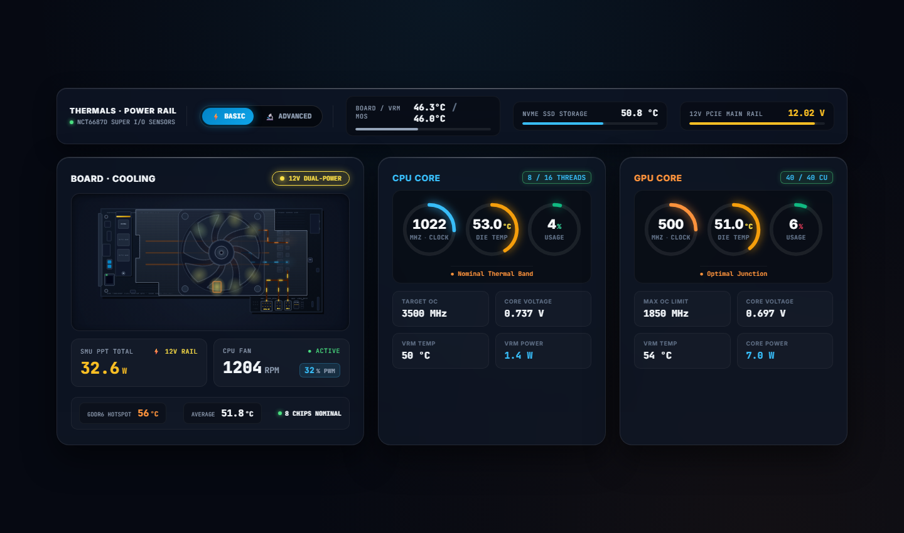
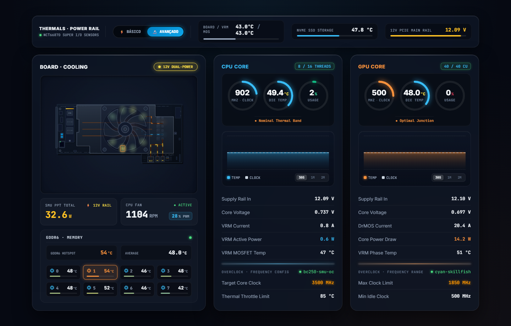
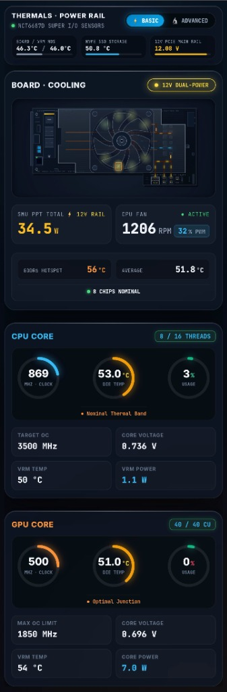
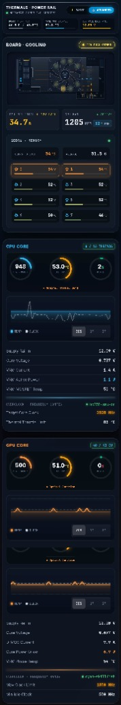
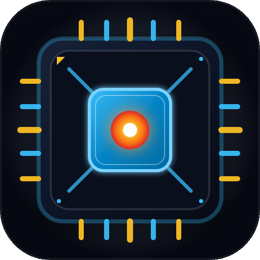
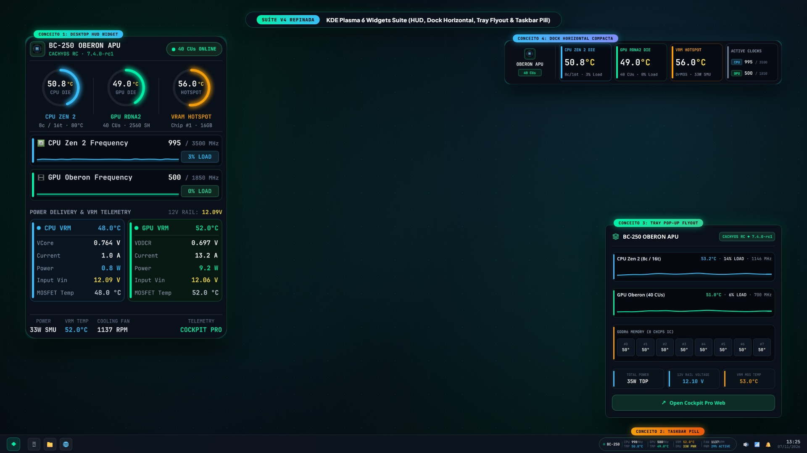
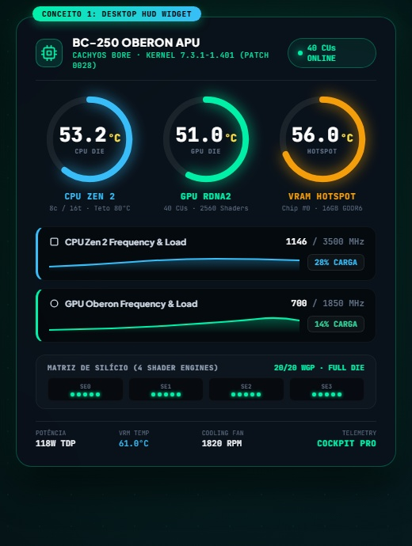
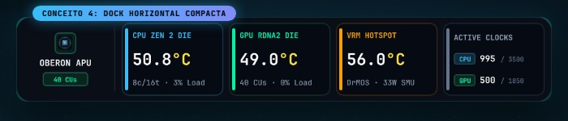
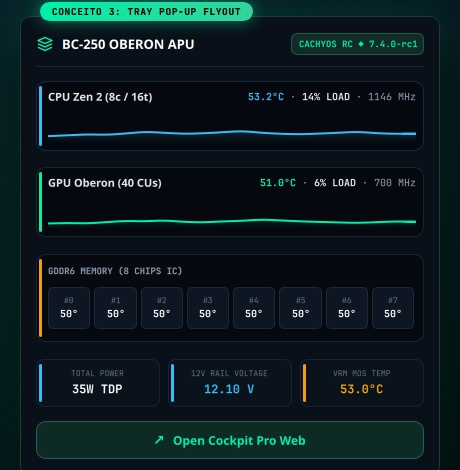
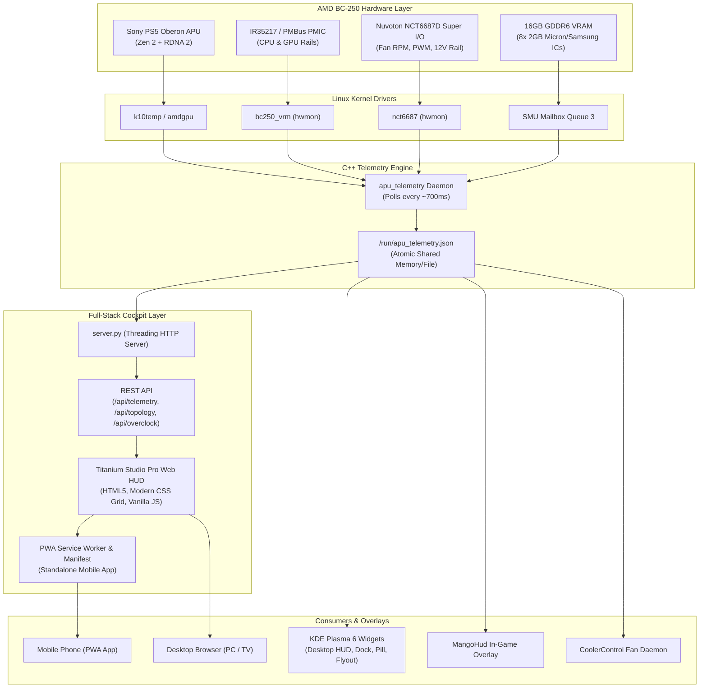

# AMD BC-250 Titanium Studio Cockpit

[](README.md)
[](LICENSE)
[](README.md)
[%20%2B%20RDNA%202%20(40%20CU)-f59e0b.svg?style=flat-square)](README.md)
[](README.md)

**AMD BC-250 Titanium Studio Cockpit** is an industrial-grade telemetry daemon, animated vector dashboard, native **KDE Plasma 6 Cyber Widgets Suite**, and standalone Progressive Web App (PWA) tailored specifically for the **AMD BC-250** (Sony PS5 *Oberon* / *Cyan Skillfish*, `gfx1013`, PCI ID `1002:13fe`).

Engineered specifically for enthusiasts running **CachyOS Linux** (with [MastaG's BC-250 kernels](https://github.com/MastaG/linux-cachyos-bc250)), this suite merges real-time low-level PMBus/VRM telemetry, Nuvoton NCT6687D Super I/O sensors, SMU mailbox memory channels, and Linux hwmon statistics into an ultra-fast, low-overhead monitoring cockpit.

---

## 📸 Cockpit Showcase

| Desktop: Basic Mode (Clean & Focused) | Desktop: Advanced Mode (Engineering Deep-Dive) |
| :---: | :---: |
|  |  |

| Mobile: Basic View (Daily Drive) | Mobile: Advanced View (Telemetry) | Official App Icon (Oberon Die) |
| :---: | :---: | :---: |
|  |  |  |

---

### 🐧 KDE Plasma 6 Cyber Widgets Suite (Native CachyOS)

| CachyOS KDE Plasma 6 Widgets Suite |
| :---: |
|  |

| Concept 1: Desktop HUD | Concept 4: Horizontal Dock | Concept 3: Tray Flyout | Concept 2: Taskbar Pill |
| :---: | :---: | :---: | :---: |
|  |  |  |  |

---

## ⚡ Key Innovations & Features

### 1. 🐧 Native KDE Plasma 6 Cyber Widgets Suite (`org.cachyos.bc250.cockpit`)
* **All-in-One Smart Plasmoid:** Automatically detects whether it is running directly on the Desktop workspace or docked inside a Panel/Taskbar, seamlessly adapting its presentation mode.
* **4 Turnkey Layout Concepts:**
  * **Concept 1 — Desktop HUD Widget:** Dedicated circular hero gauges for CPU Die, GPU Die, and VRAM Hotspot; dynamic live frequency curves; independent CPU & GPU VRM telemetry cards equipped with inset rounded neon accent capsules; and a bottom status bar with **smooth 20 FPS exponential interpolation** on Fan RPM and SMU Power.
  * **Concept 2 — Taskbar Pill:** Ultra-compact 352x32px status capsule with fixed-width anti-jitter segments showing CPU, GPU, VRM, and Fan speeds with live clock readouts. Clicking the pill opens the Tray Pop-up Flyout.
  * **Concept 3 — Tray Pop-up Flyout:** Interactive system tray pop-up featuring dynamic cubic Bézier spline waveforms tracking **live CPU & GPU % LOAD** in real time, native vector silicon architecture icon, 8-chip GDDR6 heatmap, board power draw, and a one-click launcher for Cockpit Pro Web.
  * **Concept 4 — Horizontal Compact Dock:** Multi-tile streamlined horizontal dock with inset colored neon capsules (Blue CPU, Green GPU, Amber VRM, Slate Clocks) and Oberon APU identity badge.
* **Dynamic Kernel Detection:** Automatically inspects `/proc/version` and renders the active kernel release (e.g. `CACHYOS RC ◆ 7.4.0-rc1`) in the header badge.
* **Inset Rounded Accent Bars:** Precision-engineered inset accent bars (`width: 3`, `radius: 2`, margins calibrated) across all cards for a unified cyberpunk aesthetic.
* **100% Native & Hardware-Accelerated:** Written in pure Qt 6 / QML, rendered via Vulkan/OpenGL at monitor refresh rate with near-zero CPU and RAM overhead.
* **Turnkey Setup:** Bundled directly into `install.sh`, registering the widget automatically for instant use in the KDE Plasma 6 "Add Widgets" menu.

### 2. 🎛️ Dual-Mode Web Cockpit (Basic vs. Advanced)
* **⚡ Basic Mode (Daily Driving & Gaming):** Clean, non-distracting visual hierarchy displaying primary CPU/GPU temperatures, clocks, fan speed/PWM, VRM power draws, GDDR6 hotspot, and overall board thermals.
* **🔬 Advanced Mode (Hardware Analytics & Overclocking):** Real-time SVG laser charts (temperature vs. clock curves with 30s/1m/2m windows), per-rail telemetry (Vin, Vout, DrMOS currents, VRM MOSFET phase temperatures), SMU overclock targets, and full individual 8-channel GDDR6 chip thermals.
* **⚡ 12V Micro-Fit Power Toggle:** Interactive power toggle defaulting to PCIe power only upon fresh install, with an informative one-time guidance popover for users powering auxiliary 12V Micro-Fit connectors.
* **💾 State Persistence:** Selected cockpit mode is stored locally in the browser (`localStorage`), remembering your preferred view across reboots and devices.

### 3. 📱 Native PWA Standalone Mobile App
* **Zero Browser Overhead:** Installable directly to the home screen on Android, iOS, Windows, and Linux via Web App Manifest (`manifest.json`) and a dedicated Service Worker (`sw.js`).
* **Standalone Immersive Mode:** Launches in full screen without browser URL bars, tabs, or navigation chrome, styled with native `#060912` dark titanium status bars.
* **Custom App Icon Suite:** High-definition handcrafted vector icon representing the *Oberon Silicon Die* with glowing thermal core and micro-traces (available in 16x16, 32x32, 180x180, 192x192, 512x512, and maskable formats).

### 4. 🌀 Live Animated Vector Board Diagram
* **Interactive SVG Vector Illustration:** Accurately models the physical AMD BC-250 PCB.
* **PWM-Driven Cooling Turbine:** The central blower fan animates in real time, synchronizing its rotation speed dynamically with the actual NCT6687D fan RPM and PWM percentage.
* **Thermal Heat-Glow Gradients:** The APU die and individual GDDR6 ICs dynamically transition from cool cyan to amber and saturated crimson as junction temperatures increase.
* **Live Power Inflow Animation:** Visual electron flow tracks along the 12V PCIe power rail, dual 12V Micro-Fit connectors, and VRM phases.

### 5. 🧠 8-Channel GDDR6 VRAM Telemetry
* **Individual Chip Readouts:** Direct telemetry for all 8 GDDR6 physical memory chips (`#0` through `#7`) via SMU queue 3 mailbox interrogation.
* **Dynamic Hotspot Highlighting:** Automatically calculates the board average and flags the hottest physical memory chip with an illuminated warning badge and distinct outline.
* **Mobile-Responsive Grid:** Automatically switches layout on mobile viewports (`<= 600px`), completely eliminating numeric overlap.

### 6. 🔬 Comprehensive Sensor Fusion & Engine
* **VRM PMBus Sensors:** Reads CPU rail and GPU rail voltages (`vin`, `vout`), currents (`iout`), active power (`pout`), and VRM MOSFET temperatures directly from `bc250_vrm` (NCT6687 SMBus without hardware mods on v1.1.0+) or direct PMBus at `0x60`.
* **Dynamic Core/Thread Detection:** Intelligently discovers physical cores and logical threads (`8C / 16T` on unlocked dies, `6C / 12T` on salvage units) through `/api/topology`.
* **Accurate Utilization Metrics:** True CPU load calculated from `/proc/stat` delta times and GPU core busy percent from DRM sysfs.

---

## 🛠️ System Architecture



---

## 📋 Hardware Overview: AMD BC-250 Mining Blade

The **AMD BC-250** is a unique, high-density computing board repurposed from Sony PlayStation 5 APU dies. Originally manufactured as mining blades, these boards provide remarkable performance per watt when paired with Linux:

| Specification | Details |
| :--- | :--- |
| **APU Codename** | Sony Oberon / AMD Cyan Skillfish (`gfx1013`, PCI `1002:13fe`) |
| **CPU Architecture** | **6 Cores / 12 Threads** (Factory Stock) · Unlockable up to **8 Cores / 16 Threads** AMD Zen 2 (up to 3.5 GHz, silicon lottery dependent) |
| **GPU Architecture** | **24 Compute Units / 1536 Shaders** (Factory Stock) · Unlockable up to **36, 38, or 40 CUs (up to 2560 Shaders)** AMD RDNA 2 (silicon lottery dependent) |
| **Memory System** | 16 GB GDDR6 unified across a 256-bit bus (8 physical chips) |
| **Super I/O Controller** | Nuvoton NCT6687D (manages fan PWM, tachometer, thermal diodes, and voltage sensing) |
| **Power Inputs** | **Triple 12V Power Inputs** (1x Standard PCIe 8-pin + 2x Auxiliary Molex Micro-Fit 3.0 connectors for high-current overclock stability) |
| **Supported OS** | CachyOS Linux (all [MastaG BC-250 kernels](https://github.com/MastaG/linux-cachyos-bc250): standard, BORE, sched-ext) | Arch Linux |

---

## ⚙️ Prerequisites & Kernel Drivers

For **Cockpit Pro** to capture all hardware sensors (VRM power draw, voltages, fan tachometer/PWM, and individual GDDR6 memory chip temperatures), your Linux system needs the appropriate kernel modules:

### 1. Recommended Kernels & Distributions
* **CachyOS with [MastaG's BC-250 Kernels](https://github.com/MastaG/linux-cachyos-bc250) (Highly Recommended):** Developer **[MastaG](https://github.com/MastaG/linux-cachyos-bc250)** integrates all Oberon APU fixes, frequency patches, and sensor modules across **all** of his CachyOS BC-250 kernels (standard `linux-cachyos-bc250`, `linux-cachyos-sched-ext-bc250`, etc.). If you are running any of MastaG's BC-250 kernels, all required sensor drivers (`nct6687`, `bc250_vrm 1.1.0+`, and `bc250_memory`) are already built-in and enabled out of the box!
* **Arch Linux & Other Kernels:** You do **not** need to do any physical jumper wire mods! You can simply install or update the sensor drivers via DKMS (see instructions below) to enable full PMBus/VRM access over the existing NCT6687 SMBus entirely in software.

### 2. Essential Kernel Modules

* **`nct6687` (Super I/O Controller):**
  * **Telemetry:** Blower fan RPM, dynamic fan PWM duty cycle control, motherboard temperature, VRM MOS temperature diode, and 12V PCIe voltage rail.
  * **Loading:** Usually autoloaded by the kernel. You can manually load it with:
    ```bash
    sudo modprobe nct6687
    ```

* **`bc250_vrm` (PMBus / VRM Controller):**
  * **Telemetry:** CPU & GPU core voltages (`Vout`), supply voltage (`Vin`), DrMOS current (`Iout`), active power draw (`Pout`), and VRM MOSFET phase temperatures.
  * **Zero Hardware Mod Required:** Version `1.1.0` or newer reads the Intersil PMBus controller directly over the NCT6687 SMBus path with **no soldering or jumper wires required**!
  * **Source:** [Hexxeh/bc250-vrm-dkms](https://github.com/Hexxeh/bc250-vrm-dkms) (or pre-installed in MastaG's CachyOS BC-250 kernels).

* **`bc250_memory` (GDDR6 VRAM Telemetry):**
  * **Telemetry:** Individual temperatures for all 8 GDDR6 memory chips and memory hotspot tracking.
  * **Source:** [Hexxeh/bc250-memory-dkms](https://github.com/Hexxeh/bc250-memory-dkms) (or pre-installed in MastaG's CachyOS BC-250 kernels).

#### 🔧 Installing / Updating the Drivers via DKMS (For systems without MastaG's kernel):
```bash
# 1. Install bc250-vrm-dkms (version 1.1.0+ enables jumper-free PMBus reading via NCT6687 SMBus):
git clone https://github.com/Hexxeh/bc250-vrm-dkms.git
cd bc250-vrm-dkms
sudo make dkms-install
sudo modprobe bc250_vrm
cd ..

# 2. Install bc250-memory-dkms (for 8-chip GDDR6 VRAM telemetry):
git clone https://github.com/Hexxeh/bc250-memory-dkms.git
cd bc250-memory-dkms
sudo make dkms-install
sudo modprobe bc250_memory
cd ..

# 3. Ensure NCT6687 Super I/O driver is active:
sudo modprobe nct6687
```

### 3. Verification Commands
```bash
# Check if kernel sensor modules are loaded:
lsmod | grep -E "nct6687|bc250"

# Check available hardware monitoring sensors:
sensors
```

---

## 🚀 Quick Start & Installation

### Option A: Standard Interactive Installation (Recommended)

Run the automated turnkey installer directly on your BC-250:

```bash
git clone https://github.com/Snk-B/BC250-Cockpit-Pro.git
cd BC250-Cockpit-Pro
sudo ./install.sh
```

The installer will automatically:
1. Detect your hardware sensors, kernel modules, and Linux distribution.
2. Compile the high-performance `apu_telemetry` binary.
3. Install and configure systemd background services (`apu-telemetry.service` and `bc250-web.service`).
4. Register the **KDE Plasma 6 Cyber Widgets Suite** (`org.cachyos.bc250.cockpit`) into both system and user plasmoids directories, deploy the icon suite, and refresh KDE sycoca.
5. Launch the Titanium Studio Pro web dashboard on port `8090`.

---

### Option B: Unattended / AI-Agent Automation (Single One-Liner)

If you are running the setup inside a script, CI runner, or an AI coding assistant (like Antigravity, Cursor, or Claude Code) where no interactive terminal prompt is available:

```bash
git clone https://github.com/Snk-B/BC250-Cockpit-Pro.git && cd BC250-Cockpit-Pro && sudo ./install.sh --dashboard=v2
```

This single command executes headlessly, configures all services, registers the KDE Plasma widgets, and verifies background health without requiring user interaction.

---

### 🖥️ How to Add the Widgets to KDE Plasma 6

Once `install.sh` finishes:

1. **Add to Desktop (Desktop HUD or Horizontal Dock):**
   * Right-click anywhere on your empty Desktop workspace.
   * Click **"Add Widgets..."** (or press `Meta+W`).
   * Search for **"BC-250 Cockpit Pro"** and drag it onto your desktop.
   * *To switch between Desktop HUD and Horizontal Dock:* Right-click the widget, select **"Configure BC-250 Cockpit Pro..."**, and choose your preferred layout under *Widget Representation*!

2. **Add to Taskbar / Panel (Taskbar Pill & Tray Flyout):**
   * Right-click on your bottom KDE Plasma Panel/Taskbar.
   * Select **"Add Widgets..."**.
   * Drag **"BC-250 Cockpit Pro"** into the panel (e.g. next to your system tray icons).
   * It will automatically render as the sleek **Taskbar Pill**!
   * Click the pill anytime to toggle the **Tray Pop-up Flyout** with dynamic Bézier load waves, memory heatmap, and instant web dashboard access.

---

### 🔍 Verification & Health Check

```bash
# Verify both daemon and web services are active and running:
systemctl status apu-telemetry.service bc250-web.service

# Inspect live telemetry stream:
journalctl -u apu-telemetry -f

# Check JSON sensor bridge:
curl -s http://localhost:8090/api/telemetry | jq .
```

---

### 🧹 Clean Uninstallation

To remove all installed files, unit files, and widgets safely:

```bash
cd BC250-Cockpit-Pro
sudo ./uninstall.sh
```

---

## 📱 Installing as a Mobile App (PWA)

To run the cockpit on your smartphone as a native, full-screen app:

1. Connect your phone to the same local Wi-Fi / LAN as the BC-250.
2. Open Google Chrome (or Edge/Samsung Internet) and visit:
   ```text
   http://<YOUR_BC250_IP>:8090/
   ```
3. **Enable Local Network PWA Installation (Chrome Android):**
   * In Chrome, open `chrome://flags`.
   * Search for `Insecure origins treated as secure`.
   * Set to **Enabled** and add `http://<YOUR_BC250_IP>:8090`.
   * Tap **Relaunch**.
4. Return to the dashboard, tap the **3 dots** menu, and select **"Install App"** (or **"Add to Home Screen"**).
5. The **BC-250** app icon will appear on your launcher and open in standalone mode!

---

## 📡 REST API Documentation

The bundled HTTP server serves live telemetry and system configuration over JSON endpoints:

### 1. `GET /api/telemetry`
Returns the atomic snapshot updated every ~700 ms.

```json
{
  "hardware": {
    "cpu": {
      "valid": true,
      "vin": 12.10,
      "vout": 0.737,
      "iout": 1.5,
      "pout": 1.1,
      "temp": 48.0
    },
    "gpu": {
      "valid": true,
      "vin": 12.10,
      "vout": 0.697,
      "iout": 9.4,
      "pout": 6.5,
      "temp": 50.0
    },
    "total_power": 32.4,
    "total_power_valid": true
  },
  "software": {
    "cpu_temp_c": 50.9,
    "cpu_freq_mhz": 867,
    "cpu_usage_pct": 3.0,
    "gpu_temp_c": 47.0,
    "gpu_freq_mhz": 500,
    "gpu_busy_pct": 0.0,
    "board_temp_c": 42.5,
    "vrmmos_temp_c": 42.5,
    "nvme_temp_c": 47.8,
    "fan_rpm": 1079,
    "fan_pwm": 70,
    "fan_pwm_pct": 27
  },
  "memory": {
    "valid": true,
    "status": "ok",
    "chips_c": [50, 48, 46, 48, 48, 50, 46, 42],
    "average_c": 47.3,
    "hotspot_c": 50.0,
    "hotspot_chip": 0
  }
}
```

### 2. `GET /api/topology`
Returns physical and logical core counts and active GPU Compute Units:
```json
{
  "cpu_physical_cores": 8,
  "cpu_logical_cores": 16,
  "gpu_cu_active": 40
}
```

### 3. `GET /api/overclock`
Returns active overclock profile and frequency targets (reads `/etc/default/bc250-smu-oc`):
```json
{
  "configured": true,
  "service_active": true,
  "cpu_target_mhz": 3500,
  "cpu_throttle_c": 85,
  "gpu_max_mhz": 1850,
  "gpu_min_mhz": 500
}
```

---

## 🎮 MangoHud & CoolerControl Integration

### MangoHud Overlay
The daemon writes `/run/apu_telemetry.json` continuously, allowing MangoHud to display VRM voltages, GDDR6 hotspot, and fan RPM in-game without polling overhead:

Add to your `~/.config/MangoHud/MangoHud.conf`:
```ini
# Option 1: Direct kernel sensor reader (recommended, zero overhead)
custom_text=CPU VRM
exec=cat /run/bc250/cpu_vrm_c
custom_text=GPU VRM
exec=cat /run/bc250/gpu_vrm_c
custom_text=VRM Power
exec=cat /run/bc250/total_power
custom_text=MEM MAX
exec=cat /run/bc250/memory_hotspot_c

# Option 2: Script wrapper (replace <your-user> with your Linux username)
# exec=python3 /home/<your-user>/BC250-Cockpit-Pro/mangohud/bc250_mangohud.py
```

### CoolerControl
Point CoolerControl to the `/run/apu_telemetry.json` sensor file to build custom dynamic fan curves governed by the GDDR6 hotspot or VRM MOSFET temperatures.

---

## 🤝 Upstream Heritage & Acknowledgements

This project builds upon the foundational reverse-engineering and research by the open-source BC-250 community:
* **[MastaG (Dennis Møller)](https://github.com/MastaG/linux-cachyos-bc250)** — Dedicated AMD BC-250 kernel maintenance ([linux-cachyos-bc250](https://github.com/MastaG/linux-cachyos-bc250)), Oberon APU patch integration across all CachyOS BC-250 kernels, and hardware community enablement.
* **[Hexxeh/bc250-vrm-dkms](https://github.com/Hexxeh/bc250-vrm-dkms)** — Pioneering NCT6687 SMBus driver implementation for the BC-250 PMIC and jumper-free VRM telemetry.
* **[onlinermm/BC250-Telemetry](https://github.com/onlinermm/BC250-Telemetry)** — Original C++ daemon architecture and SMU mailbox reader.
* **Titanium Studio Pro UI & PWA Edition** — Authored and refined by **Davidson Braga** with full mobile responsiveness, PWA architecture, custom Oberon icon suite, dual-mode cockpit, native KDE Plasma 6 cyber widgets suite, and dynamic CPU/GPU utilization telemetry.

---

## 📄 License

This project is licensed under the **MIT License** — see the [LICENSE](LICENSE) file for details.
