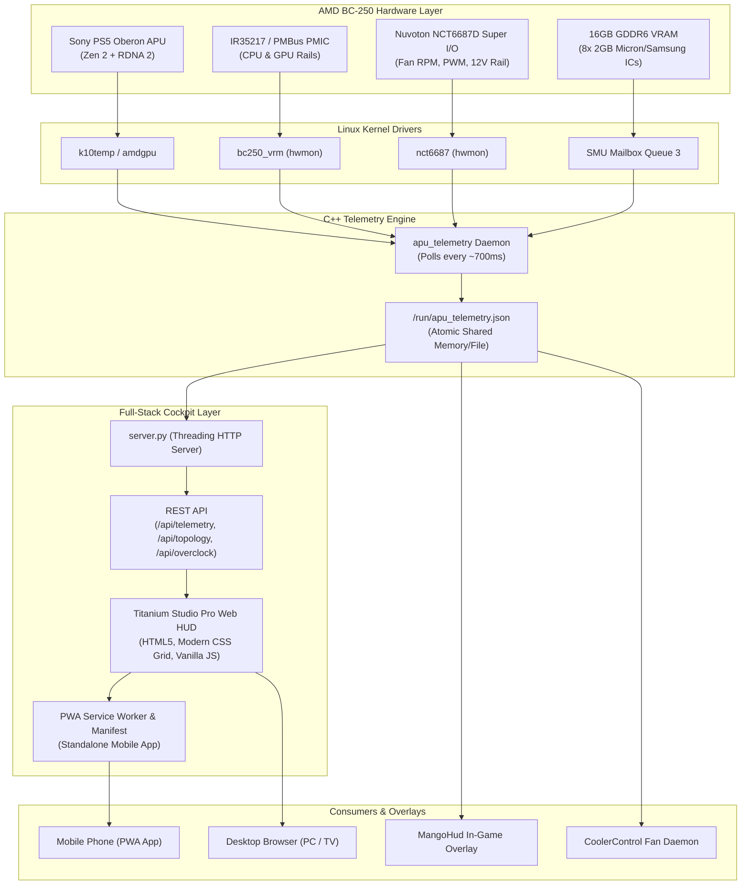

# AMD BC-250 Titanium Studio Cockpit

[](README.md)
[](LICENSE)
[](README.md)
[%20%2B%20RDNA%202%20(40%20CU)-f59e0b.svg?style=flat-square)](README.md)
[](README.md)

**AMD BC-250 Titanium Studio Cockpit** is an industrial-grade telemetry daemon, animated vector dashboard, and standalone Progressive Web App (PWA) tailored specifically for the **AMD BC-250** (Sony PS5 *Oberon* / *Cyan Skillfish*, `gfx1013`, PCI ID `1002:13fe`).

Engineered for enthusiasts running Linux gaming systems (**CachyOS**, **Bazzite**, and **SteamOS**), this suite merges real-time low-level PMBus/VRM telemetry, Nuvoton NCT6687D Super I/O sensors, SMU mailbox memory channels, and Linux hwmon statistics into an ultra-fast, low-overhead monitoring cockpit.

---

## 📸 Cockpit Showcase

| Desktop: Basic Mode (Clean & Focused) | Desktop: Advanced Mode (Engineering Deep-Dive) |
| :---: | :---: |
|  |  |

| Mobile: Basic View (Daily Drive) | Mobile: Advanced View (Telemetry) | Official App Icon (Oberon Die) |
| :---: | :---: | :---: |
|  |  |  |

---

## ⚡ Key Innovations & Features

### 1. 🎛️ Dual-Mode Cockpit (Basic vs. Advanced)
* **⚡ Basic Mode (Daily Driving & Gaming):** Clean, non-distracting visual hierarchy displaying primary CPU/GPU temperatures, clocks, fan speed/PWM, VRM power draws, GDDR6 hotspot, and overall board thermals.
* **🔬 Advanced Mode (Hardware Analytics & Overclocking):** Real-time SVG laser charts (temperature vs. clock curves with 30s/1m/2m windows), per-rail telemetry (Vin, Vout, DrMOS currents, VRM MOSFET phase temperatures), SMU overclock targets, and full individual 8-channel GDDR6 chip thermals.
* **💾 State Persistence:** Selected cockpit mode is stored locally in the browser (`localStorage`), remembering your preferred view across reboots and devices.

### 2. 📱 Native PWA Standalone Mobile App
* **Zero Browser Overhead:** Installable directly to the home screen on Android, iOS, Windows, and Linux via Web App Manifest (`manifest.json`) and a dedicated Service Worker (`sw.js`).
* **Standalone Immersive Mode:** Launches in full screen without browser URL bars, tabs, or navigation chrome, styled with native `#060912` dark titanium status bars.
* **Custom App Icon Suite:** High-definition handcrafted vector icon representing the *Oberon Silicon Die* with glowing thermal core and micro-traces (available in 16x16, 32x32, 180x180, 192x192, 512x512, and maskable formats).

### 3. 🌀 Live Animated Vector Board Diagram
* **Interactive SVG Vector Illustration:** Accurately models the physical AMD BC-250 PCB.
* **PWM-Driven Cooling Turbine:** The central blower fan animates in real time, synchronizing its rotation speed dynamically with the actual NCT6687D fan RPM and PWM percentage.
* **Thermal Heat-Glow Gradients:** The APU die and individual GDDR6 ICs dynamically transition from cool cyan to amber and saturated crimson as junction temperatures increase.
* **Live Power Inflow Animation:** Visual electron flow tracks along the 12V PCIe power rail, 12V Micro-Fit connector, and VRM phases.

### 4. 🧠 8-Channel GDDR6 VRAM Telemetry
* **Individual Chip Readouts:** Direct telemetry for all 8 GDDR6 physical memory chips (`#0` through `#7`) via SMU queue 3 mailbox interrogation.
* **Dynamic Hotspot Highlighting:** Automatically calculates the board average and flags the hottest physical memory chip with an illuminated warning badge and distinct outline.
* **Mobile-Responsive 2-Column Grid:** Automatically switches from 4 columns to 2 columns on mobile viewports (`<= 600px`), completely eliminating numeric overlap (`#0 52 °C`).

### 5. 🔬 Comprehensive Sensor Fusion & Engine
* **VRM PMBus Sensors:** Reads CPU rail and GPU rail voltages (`vin`, `vout`), currents (`iout`), active power (`pout`), and VRM MOSFET temperatures directly from `bc250_vrm` (NCT6687 SMBus without hardware mods on v1.1.0+) or direct PMBus at `0x60`.
* **Dynamic Core/Thread Detection:** Intelligently discovers physical cores and logical threads (`8C / 16T` on unlocked dies, `6C / 12T` on salvage units) through `/api/topology`.
* **Accurate Utilization Metrics:** True CPU load calculated from `/proc/stat` delta times and GPU core busy percent from DRM sysfs.

---

## 🛠️ System Architecture



---

## 📋 Hardware Overview: AMD BC-250 Mining Blade

The **AMD BC-250** is a unique, high-density computing board repurposed from Sony PlayStation 5 APU dies. Originally manufactured as mining blades, these boards provide remarkable performance per watt when paired with Linux:

| Specification | Details |
| :--- | :--- |
| **APU Codename** | Sony Oberon / AMD Cyan Skillfish (`gfx1013`, PCI `1002:13fe`) |
| **CPU Architecture** | 8 Cores / 16 Threads AMD Zen 2 (up to 3.5 GHz) |
| **GPU Architecture** | 40 Compute Units (CUs) / 2560 Shaders AMD RDNA 2 |
| **Memory System** | 16 GB GDDR6 unified across a 256-bit bus (8 physical chips) |
| **Super I/O Controller** | Nuvoton NCT6687D (manages fan PWM, tachometer, thermal diodes) |
| **Power Inputs** | Dual 12V Rails (Standard 12V PCIe 8-pin + 12V Micro-Fit connector) |
| **Supported OS** | CachyOS (`linux-cachyos-bore-bc250`), Bazzite, SteamOS |

---

## 🚀 Quick Start & Installation

### Option A: Automated One-Line Installation (Recommended)

Run the automated installer on your BC-250:

```bash
git clone https://github.com/Snk-B/BC250-Cockpit-Pro.git
cd BC250-Cockpit-Pro
sudo ./install.sh
```

The installer will:
1. Detect your Linux distribution (CachyOS, Bazzite, SteamOS).
2. Install dependencies (g++, make, python3, lm_sensors).
3. Compile the optimized `apu_telemetry` binary.
4. Set up and enable systemd background services (`apu_telemetry.service` and `bc250-web.service`).
5. Launch the Titanium Studio Pro web dashboard on port `8090`.

### Option B: Manual Setup

1. **Compile the Daemon:**
   ```bash
   g++ -O3 -std=c++20 bc250_telemetry.cpp -o apu_telemetry
   sudo cp apu_telemetry /usr/local/bin/
   ```

2. **Install Systemd Units:**
   ```bash
   sudo cp apu-telemetry.service /etc/systemd/system/
   sudo cp web/bc250-web.service /etc/systemd/system/
   sudo systemctl daemon-reload
   sudo systemctl enable --now apu-telemetry.service bc250-web.service
   ```

3. **Access the Dashboard:**
   Open your browser and navigate to:
   ```text
   http://<YOUR_BC250_IP>:8090/
   ```

---

## 📱 Installing as a Mobile App (PWA)

To run the cockpit on your smartphone as a native, full-screen app:

1. Connect your phone to the same local Wi-Fi / LAN as the BC-250.
2. Open Google Chrome (or Edge/Samsung Internet) and visit:
   ```text
   http://<YOUR_BC250_IP>:8090/
   ```
3. **Enable Local Network PWA Installation (Chrome Android):**
   * In Chrome, open `chrome://flags`.
   * Search for `Insecure origins treated as secure`.
   * Set to **Enabled** and add `http://<YOUR_BC250_IP>:8090`.
   * Tap **Relaunch**.
4. Return to the dashboard, tap the **3 dots** menu, and select **"Install App"** (or **"Add to Home Screen"**).
5. The **BC-250** app icon will appear on your launcher and open in standalone mode!

---

## 📡 REST API Documentation

The bundled HTTP server serves live telemetry and system configuration over JSON endpoints:

### 1. `GET /api/telemetry`
Returns the atomic snapshot updated every ~700 ms.

```json
{
  "hardware": {
    "cpu": {
      "valid": true,
      "vin": 12.10,
      "vout": 0.737,
      "iout": 1.5,
      "pout": 1.1,
      "temp": 48.0
    },
    "gpu": {
      "valid": true,
      "vin": 12.10,
      "vout": 0.697,
      "iout": 9.4,
      "pout": 6.5,
      "temp": 50.0
    },
    "total_power": 32.4,
    "total_power_valid": true
  },
  "software": {
    "cpu_temp_c": 50.9,
    "cpu_freq_mhz": 867,
    "cpu_usage_pct": 3.0,
    "gpu_temp_c": 47.0,
    "gpu_freq_mhz": 500,
    "gpu_busy_pct": 0.0,
    "board_temp_c": 42.5,
    "vrmmos_temp_c": 42.5,
    "nvme_temp_c": 47.8,
    "fan_rpm": 1079,
    "fan_pwm": 70,
    "fan_pwm_pct": 27
  },
  "memory": {
    "valid": true,
    "status": "ok",
    "chips_c": [50, 48, 46, 48, 48, 50, 46, 42],
    "average_c": 47.3,
    "hotspot_c": 50.0,
    "hotspot_chip": 0
  }
}
```

### 2. `GET /api/topology`
Returns physical and logical core counts and active GPU Compute Units:
```json
{
  "cpu_physical_cores": 8,
  "cpu_logical_cores": 16,
  "gpu_cu_active": 40
}
```

### 3. `GET /api/overclock`
Returns active overclock profile and frequency targets (reads `/etc/default/bc250-smu-oc`):
```json
{
  "configured": true,
  "service_active": true,
  "cpu_target_mhz": 3500,
  "cpu_throttle_c": 85,
  "gpu_max_mhz": 1850,
  "gpu_min_mhz": 500
}
```

---

## 🎮 MangoHud & CoolerControl Integration

### MangoHud Overlay
The daemon writes `/run/apu_telemetry.json` continuously, allowing MangoHud to display VRM voltages, GDDR6 hotspot, and fan RPM in-game without polling overhead:

Add to your `~/.config/MangoHud/MangoHud.conf`:
```ini
# Option 1: Direct kernel sensor reader (recommended, zero overhead)
custom_text=CPU VRM
exec=cat /run/bc250/cpu_vrm_c
custom_text=GPU VRM
exec=cat /run/bc250/gpu_vrm_c
custom_text=VRM Power
exec=cat /run/bc250/total_power
custom_text=MEM MAX
exec=cat /run/bc250/memory_hotspot_c

# Option 2: Script wrapper (replace <your-user> with your Linux username)
# exec=python3 /home/<your-user>/BC250-Cockpit-Pro/mangohud/bc250_mangohud.py
```

### CoolerControl
Point CoolerControl to the `/run/apu_telemetry.json` sensor file to build custom dynamic fan curves governed by the GDDR6 hotspot or VRM MOSFET temperatures.

---

## 🤝 Upstream Heritage & Acknowledgements

This project builds upon the foundational reverse-engineering and research by the open-source BC-250 community:
* **[Hexxeh/bc250-vrm-dkms](https://github.com/Hexxeh/bc250-vrm-dkms)** — Pioneering NCT6687 SMBus driver implementation for the BC-250 PMIC.
* **[onlinermm/BC250-Telemetry](https://github.com/onlinermm/BC250-Telemetry)** — Original C++ daemon architecture and SMU mailbox reader.
* **Titanium Studio Pro UI & PWA Edition** — Authored and refined by **Davidson Braga** with full mobile responsiveness, PWA architecture, custom Oberon icon suite, dual-mode cockpit, and dynamic CPU/GPU utilization telemetry.

---

## 📄 License

This project is licensed under the **MIT License** — see the [LICENSE](LICENSE) file for details.
